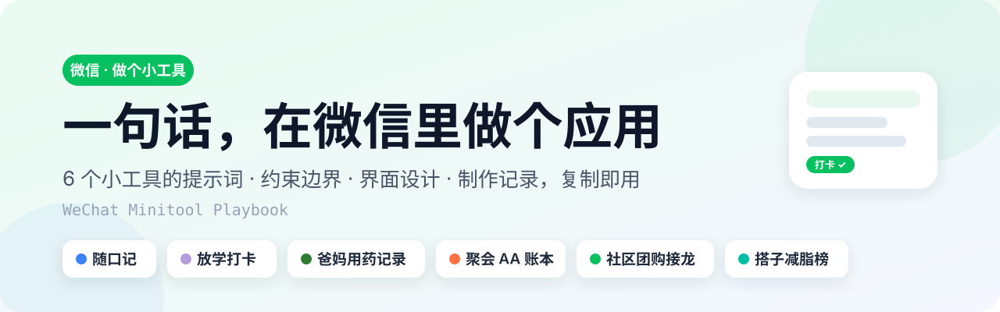
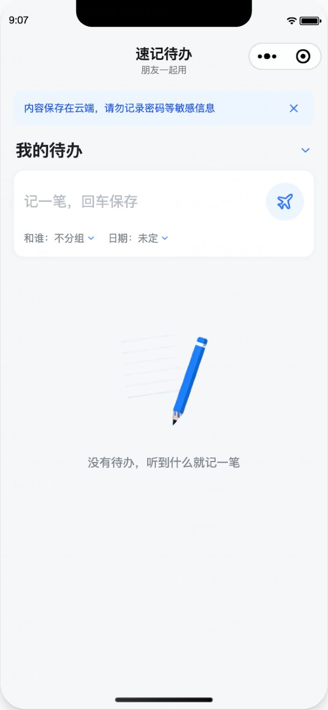
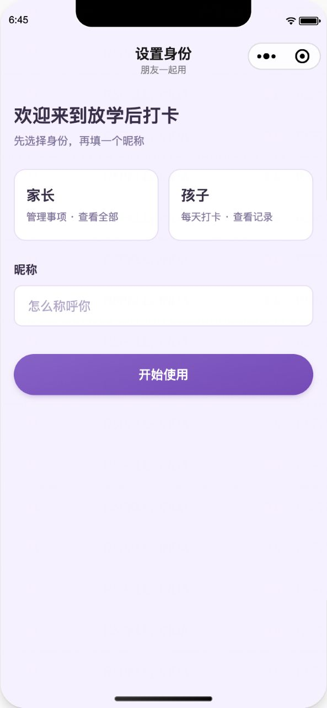
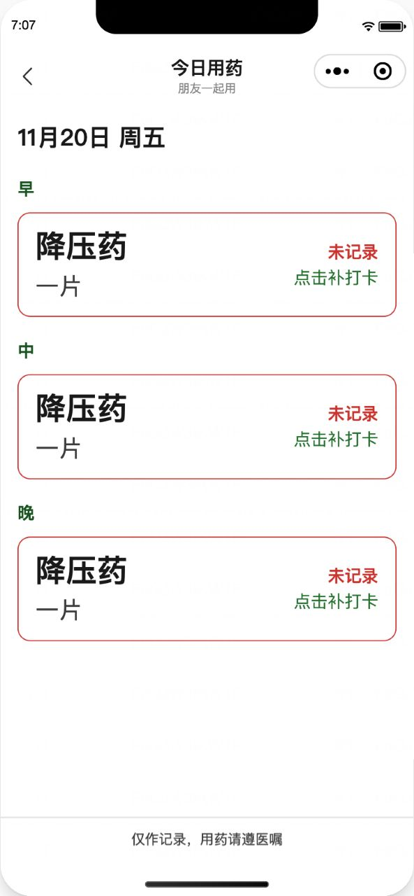
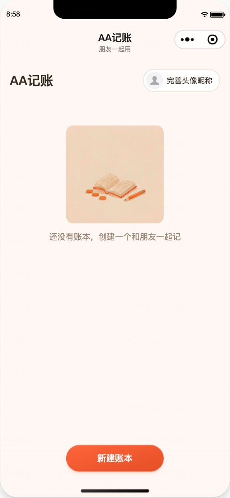
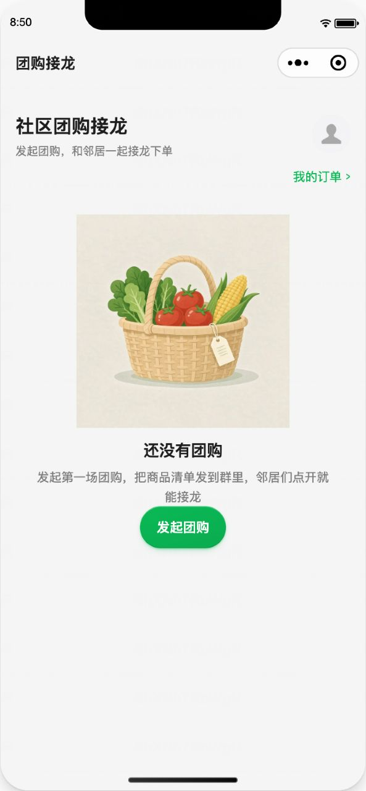
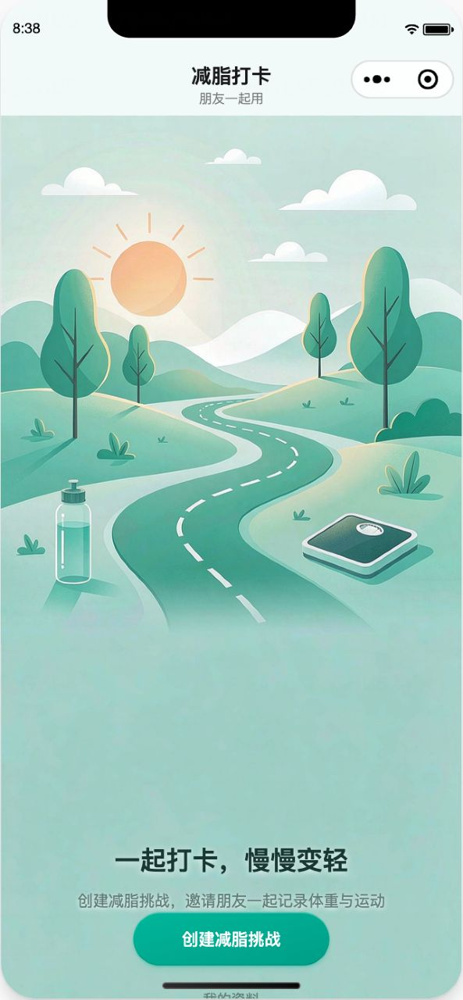
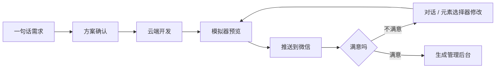

<div align="center">



# WeChat Minitool Playbook

**微信「做个小工具」实战手册**

一句话在微信里做个应用 · 提示词、约束边界、界面设计、制作记录，复制即用

[](LICENSE)
[](#-6-个小工具)
[](#-几条提醒)
[](https://github.com/Hiwoniu/wechat-minitool-playbook/stargazers)
[](https://my.feishu.cn/wiki/Eq6twbgv5irYgikOa8Pc2fHfnKg)

[6 个小工具](#-6-个小工具) · [制作流程](docs/01-制作流程.md) · [提示词技巧](docs/03-提示词技巧.md) · [为什么是小工具](docs/04-为什么是小工具.md) · [交流群](#-交流群)

</div>

<br>

> [!NOTE]
> 小工具跑在微信里，没有能放在本地的源码。**所以这个仓库收的是能复现的东西：提示词、边界规则、界面规格、验收清单，和真实的制作记录。**

微信内测了一个桌面端 AI Agent，叫「做个小工具」。你描述需求，它在云端做出一个小工具，直接在微信「小微」里打开，还能发给朋友一起用。不用注册、备案、审核。

## 🧰 6 个小工具

<table>
  <tr>
    <td width="33%" valign="top">
      <h3>📝 <a href="tools/01-随口记/">随口记</a></h3>
      <sub>我和对象 · 室友</sub><br><br>
      聊天里随口答应的事，3 秒记下，自动按「明天 / 周六」归好日期<br><br>
      
    </td>
    <td width="33%" valign="top">
      <h3>🎒 <a href="tools/02-放学打卡/">放学打卡</a></h3>
      <sub>家长 · 孩子</sub><br><br>
      放学后事项三态打卡，全家共用一份，按天按周回看<br><br>
      
    </td>
    <td width="33%" valign="top">
      <h3>💊 <a href="tools/03-爸妈用药记录/">爸妈用药记录</a></h3>
      <sub>子女 · 父母</sub><br><br>
      老人大字号一键打卡，子女远程看有没有漏服<br><br>
      
    </td>
  </tr>
  <tr>
    <td width="33%" valign="top">
      <h3>🍻 <a href="tools/04-聚会AA账本/">聚会 AA 账本</a></h3>
      <sub>一起出游的朋友</sub><br><br>
      多人一起记账，自动算出转账次数最少的结算方案<br><br>
      
    </td>
    <td width="33%" valign="top">
      <h3>🛒 <a href="tools/05-社区团购接龙/">社区团购接龙</a></h3>
      <sub>团长 · 邻居</sub><br><br>
      下单校验库存、自动汇总，门牌只有团长能看到<br><br>
      
    </td>
    <td width="33%" valign="top">
      <h3>🏃 <a href="tools/06-搭子减脂榜/">搭子减脂榜</a></h3>
      <sub>几个减肥的朋友</sub><br><br>
      按减重百分比排行，具体体重默认只有自己可见<br><br>
      
    </td>
  </tr>
</table>

### 📸 实际做出来的样子

<table>
  <tr>
    <td align="center"><br><sub>速记待办</sub></td>
    <td align="center"><br><sub>放学后打卡</sub></td>
    <td align="center"><br><sub>家庭用药打卡 · 老人端</sub></td>
  </tr>
  <tr>
    <td align="center"><br><sub>AA 记账</sub></td>
    <td align="center"><br><sub>团购接龙</sub></td>
    <td align="center"><br><sub>减脂打卡</sub></td>
  </tr>
</table>

一次成型约 6–10 分钟，自带插画和配色。客户端一次只能做一个，并行提交的会排队，需要回一句「继续」。

每个文件夹都是同一套结构：

```text
tools/01-随口记/
├── README.md     定位 · 角色权限 · 核心功能 · 约束边界 · 界面设计 · 管理后台 · 验收清单
├── prompt.md     可直接粘贴的完整提示词 + 2–3 条迭代指令
└── 制作记录.md    实测过程、耗时、踩坑和真实感受
```

为什么选这 6 个？标准只有一条：**这个需求放在微信里，是不是比放在别处更合适。** 详见 [选题思路](docs/02-选题思路.md)。

## 🔄 制作流程



改坏了随时版本回退。完整 9 步见 [制作流程](docs/01-制作流程.md)。

## 🚀 怎么用

1. 拿到「做个小工具」内测资格，安装桌面客户端（macOS / Windows）。
2. 打开想做的工具文件夹，复制 `prompt.md` 里的完整提示词。
3. 粘贴到客户端对话框，确认方案后等它在云端做完。
4. 对照 `README.md` 里的验收清单，在模拟器里切换身份逐项测。

## 📚 文档

| | 内容 | 解决什么问题 |
|:-:|---|---|
| 01 | [制作流程](docs/01-制作流程.md) | 从登录到生成管理后台的 9 步，第一次用照着走 |
| 02 | [选题思路](docs/02-选题思路.md) | 什么需求适合做成小工具，以及更多可做的方向 |
| 03 | [提示词技巧](docs/03-提示词技巧.md) | 怎么写才能一次做对，怎么改才不越改越乱 |
| 04 | [为什么是小工具](docs/04-为什么是小工具.md) | 微信为什么用小程序底座做这件事：个人观察 |

## ⚠️ 几条提醒

> [!IMPORTANT]
> **6 个工具已于 2026-11-20 全部做出来**，耗时、踩坑和截图见各自的 `制作记录.md`。身份权限隔离、结算算法、提醒、真机分享等标【需实测】的能力还没验证，以你自己试出来的为准。

- **内测阶段**：Beta 版，需要内测资格和桌面客户端，功能入口随时会变。
- **别存敏感信息**：数据在云端，密码、证件号、病历、银行卡别往里写。
- **「完全访问权限」不要随手开**：做小工具用不到。

## 🗺️ 后续更新

- [x] 6 个小工具全部做出，补齐制作记录和首页截图
- [ ] 逐项验证身份隔离、结算、隐私等功能，补真机截图
- [ ] 读者许愿：留言里点赞最高的需求，做出来放进来
- [ ] 同一个需求，不同写法的提示词效果对比

## 💬 交流群

用「做个小工具」做出了好玩的东西，或者踩了坑，欢迎来群里聊。

<a href="https://my.feishu.cn/wiki/Eq6twbgv5irYgikOa8Pc2fHfnKg"></a>

## 🤝 投稿

做出了新的小工具，欢迎提 PR：复制 [templates/新工具模板.md](templates/新工具模板.md)，在 `tools/` 下新建一个文件夹。需要有完整提示词和至少一次实测记录，截图请打码。

<div align="center">

<br>

觉得有用的话，点个 ⭐ **Star**，更新了能第一时间看到。

</div>

---

## 👤 作者

<table>
  <tr>
    <td valign="top">
      <b>向明</b><br><br>
      平时在开发里找好用的 Agent、Agent 产品、Agent 技巧和提示词，拿来给工作和生活提效。<br><br>
      GitHub：<a href="https://github.com/Hiwoniu">@Hiwoniu</a><br>
      X：<a href="https://x.com/woniu20758393">@woniu20758393</a><br><br>
      <b>扫码关注公众号</b>，新的小工具和实测复盘会先发在这里 👉
    </td>
    <td width="200" align="center">
      
    </td>
  </tr>
</table>

## 📄 License

内容采用 [CC BY 4.0](LICENSE) 协议：可以自由复制、修改、商用，转载请注明出处并附上本仓库链接。
