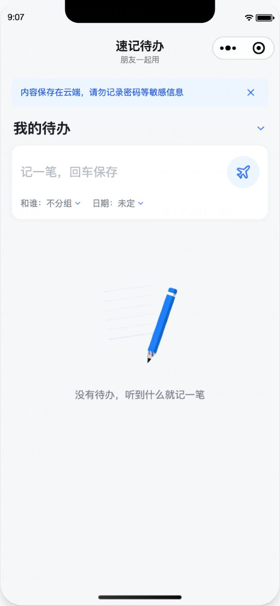

# 随口记（成品名：速记待办） · 制作记录

> 实测日期：2026-11-20，「做个小工具」桌面客户端 Beta。下面只写确实发生过的事，没验证的单独列出。

| 项目 | 记录 |
|---|---|
| 实测日期 | 2026-11-20 |
| 方案确认是否有偏差 | 没有，直接按提示词提交 |
| 云端生成耗时 | 约 24 分钟，大部分时间在排队；最后一次提交约 6 分钟做完 |
| 修改了几轮 | 1 轮（加语音输入），之后又自动补修 1 次 |
| 是否生成管理后台 | 还没试 |

## 过程

1. 第一次提交时另一个工具还在做，没绑上作品，Agent 让我等。
2. 约 18 分钟后我回「继续」，重新提交，约 6 分钟做完，Agent 自己打开模拟器截了图。
3. 首页：顶部提示「内容保存在云端，请勿记录密码等敏感信息」，常驻输入框「记一笔，回车保存」，下面是「和谁：不分组 / 日期：未定」，空状态「没有待办，听到什么就记一笔」。
4. 我追问「这个能加入语音输入吗？」，它加了麦克风按钮，约 4 分钟。
5. 它自己截图发现界面上没出现按钮，去查源码后又提交了一次修正。现在源码里有流式语音转文字（调用平台的语音识别接口）。

## 截图

## 踩坑

- 同一天并行提交了 6 个工具。客户端一次只能做一个，后提交的会排队，等完不会自动接着做，要回一句「继续」。
- Agent 每次做完会自己开模拟器截图检查，发现问题会再改，但偶尔会误报完成，要自己看一眼。

## 还没验证

- [ ] 日期识别准确率（明天 / 周六 / 下周三 / 15号 / 今晚 / 买牛奶）
- [ ] 私人清单与共享清单的隔离
- [ ] 语音按钮最终是否在界面上出现、真机能否识别
- [ ] 从打开到保存是否 3 秒内
- [ ] 推送到真机、分享给朋友后的效果
- [ ] 管理后台
