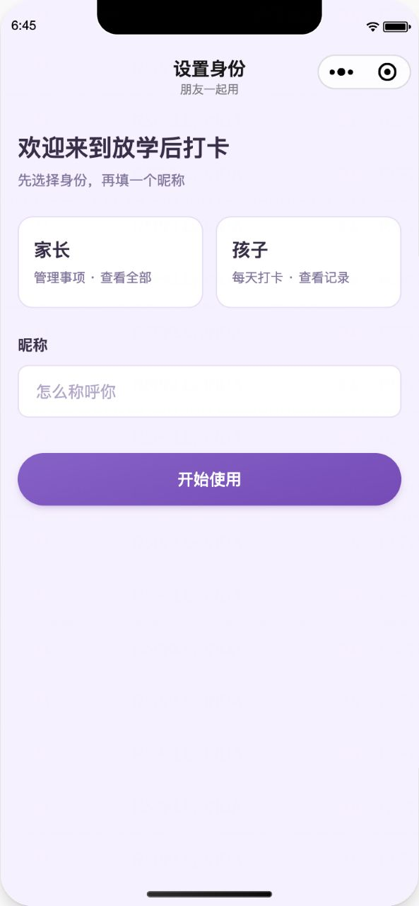

# 放学打卡（成品名：放学后打卡） · 制作记录

> 实测日期：2026-11-20，「做个小工具」桌面客户端 Beta。下面只写确实发生过的事，没验证的单独列出。

| 项目 | 记录 |
|---|---|
| 实测日期 | 2026-11-20 |
| 方案确认是否有偏差 | 没有 |
| 云端生成耗时 | 约 6 分钟，一次做成 |
| 修改了几轮 | 0 |
| 是否生成管理后台 | 还没试 |

## 过程

1. 提交后一次成型，是 6 个里最顺的。
2. 打开先选身份：家长「管理事项·查看全部」，孩子「每天打卡·查看记录」，再填昵称，点「开始使用」。
3. 页面有今天、记录、事项管理、首次设置四页，底部 tab 是「今天 / 记录」。主色紫色。

## 截图

## 踩坑

- 同一天并行提交了 6 个工具。客户端一次只能做一个，后提交的会排队，等完不会自动接着做，要回一句「继续」。
- Agent 每次做完会自己开模拟器截图检查，发现问题会再改，但偶尔会误报完成，要自己看一眼。

## 还没验证

- [ ] 孩子身份下事项管理入口是否隐藏
- [ ] 三态打卡与按周回看
- [ ] 家务积分模块（二次迭代）
- [ ] 推送到真机、分享给朋友后的效果
- [ ] 管理后台
