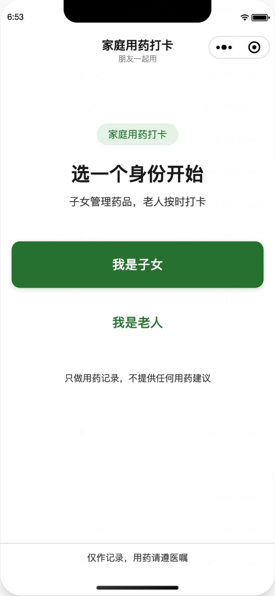
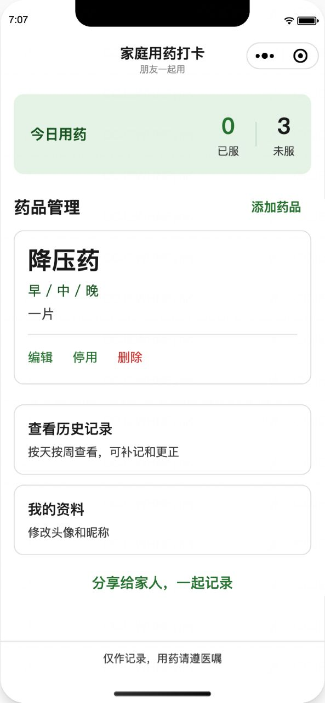
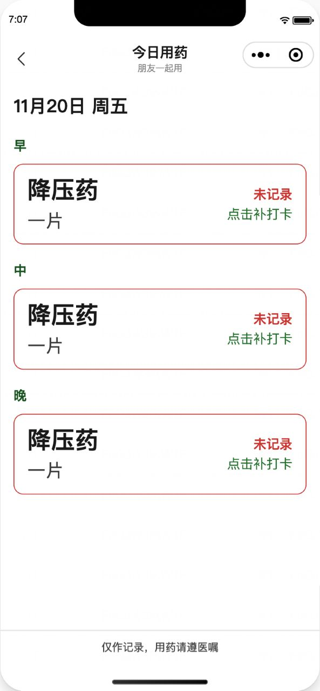

# 爸妈用药记录（成品名：家庭用药打卡） · 制作记录

> 实测日期：2026-11-20，「做个小工具」桌面客户端 Beta。下面只写确实发生过的事，没验证的单独列出。

| 项目 | 记录 |
|---|---|
| 实测日期 | 2026-11-20 |
| 方案确认是否有偏差 | 开工前 Agent 先反问了身份怎么分配 |
| 云端生成耗时 | 整体约 30 分钟，其中排队重提 3 次 |
| 修改了几轮 | Agent 自查后自己改了 3 处，我没提修改 |
| 是否生成管理后台 | 还没试 |

## 过程

1. Agent 先问了一个问题：家人的身份怎么分配。
2. 因为排队，创建重提了 3 次。
3. 第一版做出来后，它自己截图检查，改了三处：「我是老人」原来只是一行小字，改成和「我是子女」一样的整行大按钮；副标题从「朋友一起用」改成「家人一起用」（试了好几次）；用云函数清掉了演示数据。
4. 子女端：今日用药 已服 / 未服计数，药品卡片（早/中/晚、剂量、编辑/停用/删除），历史记录（按天按周，可补记和更正），分享给家人。
5. 老人端：日期 + 早/中/晚三张大卡片，过了时段的显示红字「未记录·点击补打卡」。
6. 底部固定「仅作记录，用药请遵医嘱」。

## 截图

## 踩坑

- 同一天并行提交了 6 个工具。客户端一次只能做一个，后提交的会排队，等完不会自动接着做，要回一句「继续」。
- Agent 每次做完会自己开模拟器截图检查，发现问题会再改，但偶尔会误报完成，要自己看一眼。

## 还没验证

- [ ] 老人身份能否看到/修改药品
- [ ] 子女远程看到漏服是否实时
- [ ] 让父母在真机上实际用一次
- [ ] 推送到真机、分享给朋友后的效果
- [ ] 管理后台
