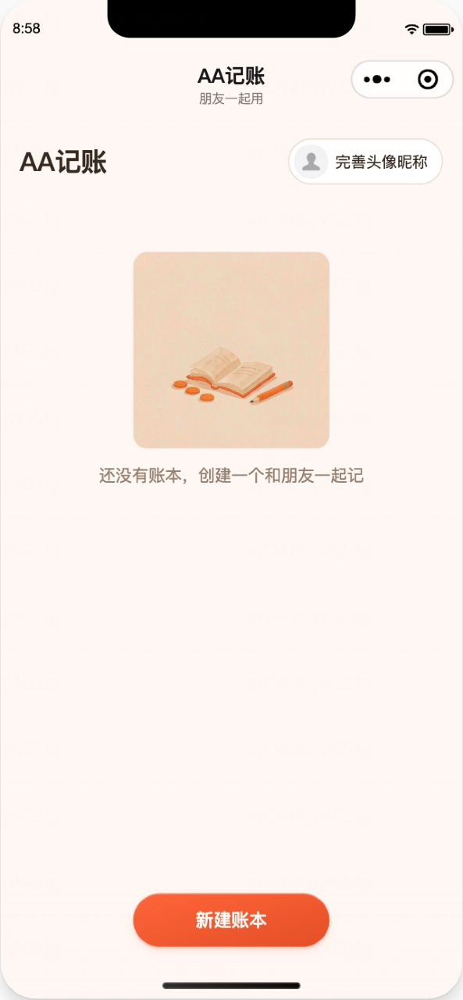

# 聚会 AA 账本（成品名：AA记账） · 制作记录

> 实测日期：2026-11-20，「做个小工具」桌面客户端 Beta。下面只写确实发生过的事，没验证的单独列出。

| 项目 | 记录 |
|---|---|
| 实测日期 | 2026-11-20 |
| 方案确认是否有偏差 | 没有 |
| 云端生成耗时 | 制作本身约 7 分钟，此前排队卡了两个多小时 |
| 修改了几轮 | 0 |
| 是否生成管理后台 | 还没试 |

## 过程

1. 连续三次提交都报「已经有一个小工具在制作中」，但项目列表是空的，Agent 让我刷新再试。
2. 两个多小时后我回「继续」，约 7 分钟做完。
3. 首页是账本列表：空状态是账本插画 +「还没有账本，创建一个和朋友一起记」，底部「新建账本」，右上「完善头像昵称」。主色橙色。

## 截图

## 踩坑

- 同一天并行提交了 6 个工具。客户端一次只能做一个，后提交的会排队，等完不会自动接着做，要回一句「继续」。
- Agent 每次做完会自己开模拟器截图检查，发现问题会再改，但偶尔会误报完成，要自己看一眼。

## 还没验证

- [ ] 最少转账结算方案是否正确（3 人 5 笔手算对照）
- [ ] 尾差处理
- [ ] 一键复制结算文字
- [ ] 推送到真机、分享给朋友后的效果
- [ ] 管理后台
