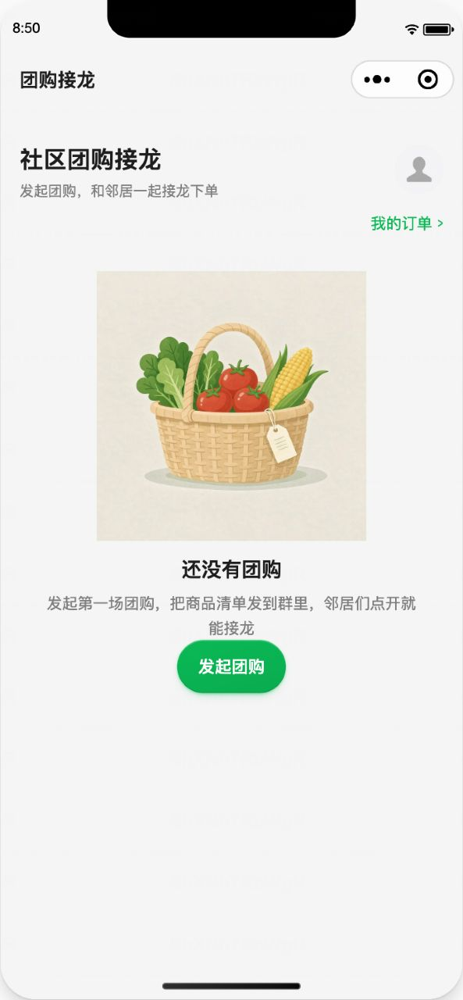

# 社区团购接龙（成品名：团购接龙） · 制作记录

> 实测日期：2026-11-20，「做个小工具」桌面客户端 Beta。下面只写确实发生过的事，没验证的单独列出。

| 项目 | 记录 |
|---|---|
| 实测日期 | 2026-11-20 |
| 方案确认是否有偏差 | 没有 |
| 云端生成耗时 | 约 10 分钟（重提后） |
| 修改了几轮 | 0 |
| 是否生成管理后台 | 还没试 |

## 过程

1. 第一次 Agent 把需求拆成两步提交，失败了。
2. 改成一句完整需求重提，我回「继续」后约 10 分钟做完。
3. 首页：「社区团购接龙·发起团购，和邻居一起接龙下单」，菜篮子插画，「还没有团购」空状态，按钮「发起团购」，右上「我的订单」。

## 截图

## 踩坑

- 同一天并行提交了 6 个工具。客户端一次只能做一个，后提交的会排队，等完不会自动接着做，要回一句「继续」。
- Agent 每次做完会自己开模拟器截图检查，发现问题会再改，但偶尔会误报完成，要自己看一眼。

## 还没验证

- [ ] 库存校验
- [ ] 重复下单视为修改
- [ ] 门牌只有团长可见
- [ ] 推送到真机、分享给朋友后的效果
- [ ] 管理后台
