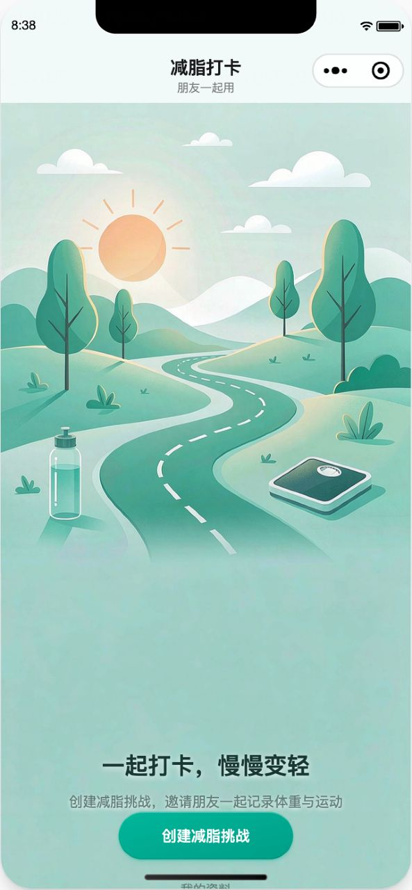

# 搭子减脂榜（成品名：减脂打卡） · 制作记录

> 实测日期：2026-11-20，「做个小工具」桌面客户端 Beta。下面只写确实发生过的事，没验证的单独列出。

| 项目 | 记录 |
|---|---|
| 实测日期 | 2026-11-20 |
| 方案确认是否有偏差 | 没有 |
| 云端生成耗时 | 约 10 分钟（补全那次） |
| 修改了几轮 | 0 |
| 是否生成管理后台 | 还没试 |

## 过程

1. 第一次 Agent 说做好了，但其实没有绑定作品。
2. 我回「继续」后，它跑了一次「确认并补全」，约 10 分钟。
3. 入口页是整屏风景插画（山路、水杯、体重秤），标语「一起打卡，慢慢变轻」，按钮「创建减脂挑战」。
4. 页面包括创建、加入、打卡、排行、趋势图（ec-canvas）、设置、资料。

## 截图

## 踩坑

- 同一天并行提交了 6 个工具。客户端一次只能做一个，后提交的会排队，等完不会自动接着做，要回一句「继续」。
- Agent 每次做完会自己开模拟器截图检查，发现问题会再改，但偶尔会误报完成，要自己看一眼。

## 还没验证

- [ ] 排行按减重百分比
- [ ] 具体体重只有自己可见
- [ ] 相差超过 3 kg 弹窗确认
- [ ] 推送到真机、分享给朋友后的效果
- [ ] 管理后台
